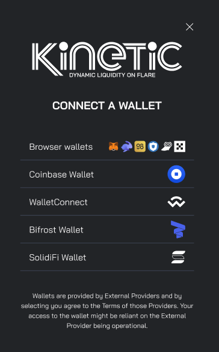

# Getting Started

Getting started with Kinetic is quick and straightforward. All you need is:

1️⃣ A Wallet on the Flare Network – Connect using Wallet Connect, MetaMask, SolidFi, or Bifrost.

2️⃣ Eligible Assets – You’ll need one of the supported tokens to supply into the market. The main market includes sFLR, USDC.e, USDT, WETH, FLRETH, while isolated markets support JOULE, USDC.e, and FLR, or additionally USDT0, and fXRP.

Once you are set up, you can start lending, borrowing, and maximizing your assets in Flare’s DeFi ecosystem. Kinetic makes it easy to jump in and take control of your financial strategy.


Always keep a small amount of FLR in your wallet for transaction fees.&#x20;


<figure><figcaption></figcaption></figure>

 

