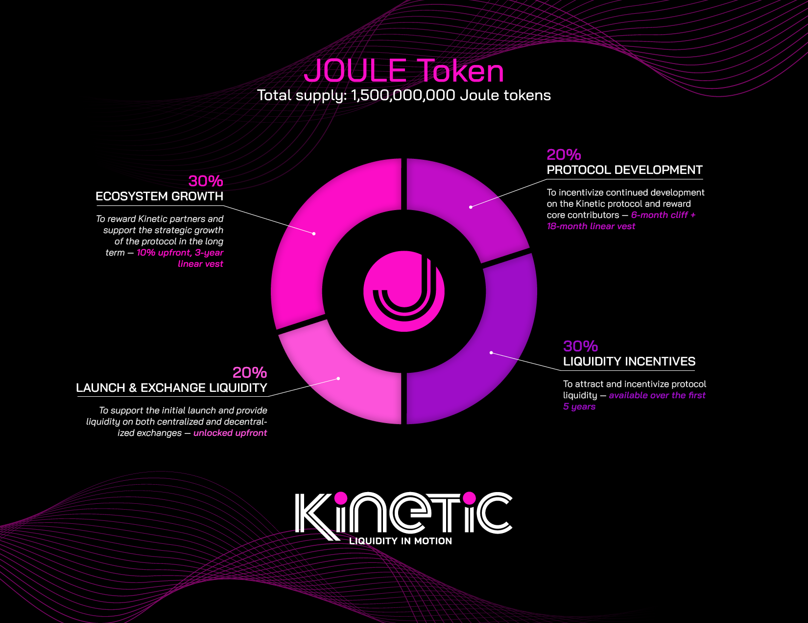

# Kinetic Tokenomics

**JOULE**, the native token of the Kinetic protocol, has a maximum supply of 1,500,000,000 tokens. Its distribution is allocated across various categories to serve different purposes within the ecosystem.

<figure><figcaption></figcaption></figure>

1. **Protocol Development (20%):** This portion is dedicated to incentivizing ongoing development on the Kinetic protocol and rewarding core contributors. Tokens are subject to a vesting schedule, with a 6-month cliff followed by an 18-month linear vesting period.
2. **Liquidity Incentives (30%):** Allocated to attract and incentivize liquidity within the protocol over the first 5 years. This incentivizes users to provide liquidity, enhancing the overall efficiency and effectiveness of the Kinetic ecosystem.
3. **Token Launch and Exchange Liquidity (20%):** These tokens are reserved to support the initial launch of the protocol and ensure liquidity on both centralized and decentralized exchanges. This portion is unlocked upfront to facilitate immediate liquidity provision.
4. &#x20;**Ecosystem Growth (30%):** Reserved to reward Kinetic partners and support the long-term strategic growth of the protocol. A portion of these tokens is distributed upfront, with the remainder subject to a 3-year linear vesting schedule.

### No Token Sale

Kinetic opts for organic growth and genuine community engagement instead of hosting a token sale. This approach aligns with the project's commitment to sustainable development and belief in the transformative potential of the platform.

