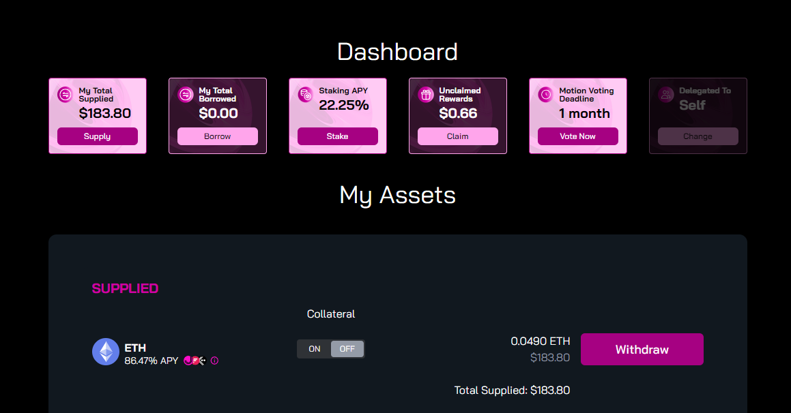

# Supply

Supplying allows you to maximize the potential of your idle assets. By depositing into Kinetic, you enable your assets to earn yield through a decentralized and secure platform. Your supplied assets are made available to borrowers, who pay fees to borrow them, thereby generating interest. Users retain the flexibility to withdraw their assets at any time, provided they are not currently used as collateral for an active loan.

## Deposit Assets

Depositing assets into the lending pool on Kinetic is a straightforward process designed for user convenience. To get started please follow these steps:

1. &#x20;Connect your wallet using one of the available wallet options from our selection. The connect wallet button is located at the top right section of your screen and on mobile it will be located in the drop-down menu.&#x20;

<figure><figcaption></figcaption></figure>

<figure><figcaption></figcaption></figure>

2. &#x20;Select your chosen asset from the supply list, then enter the amount that you would like to supply into the lending market.

<figure><figcaption>
The assets listed in the drop-down are generic for testing and educational purposes., they do not reflect the specific markets that Kinetic will launch on mainnet.  
</figcaption></figure>

3. You can enter a specific amount, use the slider button to change your chosen amount, or simply click the Max button to supply the maximum amount of that asset held in your wallet.

<figure><figcaption></figcaption></figure>

4. &#x20;Click the Approve and Supply button to deposit your assets. You will be prompted by your wallet to approve the transaction. It is important to note that even if you choose to supply an asset, it does not obligate you to borrow against it. Collateralize your supply by toggling the Use as Collateral button below the supplied asset, enabling you to borrow against your supply.

<figure><figcaption>
Confirming supply of ETH into the lending pool
</figcaption></figure>

<figure><figcaption>
ETH has been supplied
</figcaption></figure>

6. Upon depositing, your wallet will receive kTokens that serve as a receipt for your supplied assets. These kTokens are initially valued at 0.020000 and will appreciate over time based on the accruing interest rate.


Understanding the potential returns and risks associated with supplying an asset on Kinetic is essential for informed decision-making. When you supply an asset, you have the potential to earn interest as a function of supplying, however, it is crucial to be aware of the associated risks. Market conditions can change affecting the value of your supplied assets, and there is always a small possibility of protocol-associated smart contract risk. It is important to carefully consider the potential rewards against these inherent risks before deciding to supply assets to the lending markets.


## Withdrawals

1. To withdraw your assets, navigate to the dashboard and underneath the My Assets section click on the Withdraw button for the selected asset.

<figure><figcaption>
In this example, the user would be able to withdraw our chosen amount of ETH. 
</figcaption></figure>

2. &#x20;Choose the amount you wish to withdraw and submit the transaction.


Users can withdraw their assets at any point as long as funds are not being actively used as collateral. This means that if your deposited assets are not tied up in securing a loan, and their withdrawal won't disrupt any ongoing borrowings, you are free to withdraw them at any time.

